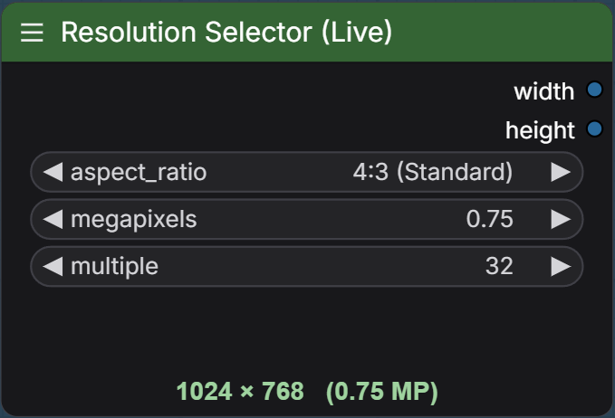

# Resolution Selector (Live)

A ComfyUI custom node that improves the stock Resolution Selector with a live width × height readout. Same aspect-ratio, megapixel, and multiple maths as the core node; the calculated size updates on the node as you change any setting.

## Install

Clone or copy this folder into `ComfyUI/custom_nodes` (this package is named `resolution-selector-live`), then restart ComfyUI. Search for **Resolution Selector (Live)** under utilities.

## Screenshot

License: MIT (Copyright (c) 2026 NikoDemon80).
